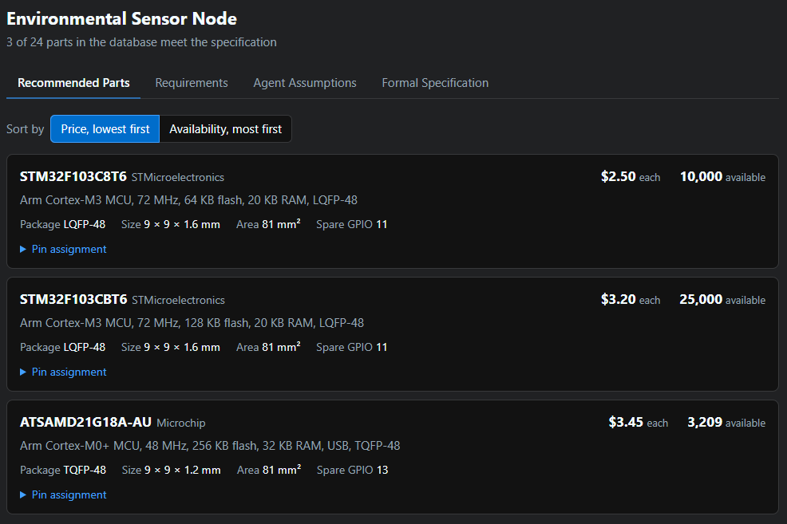
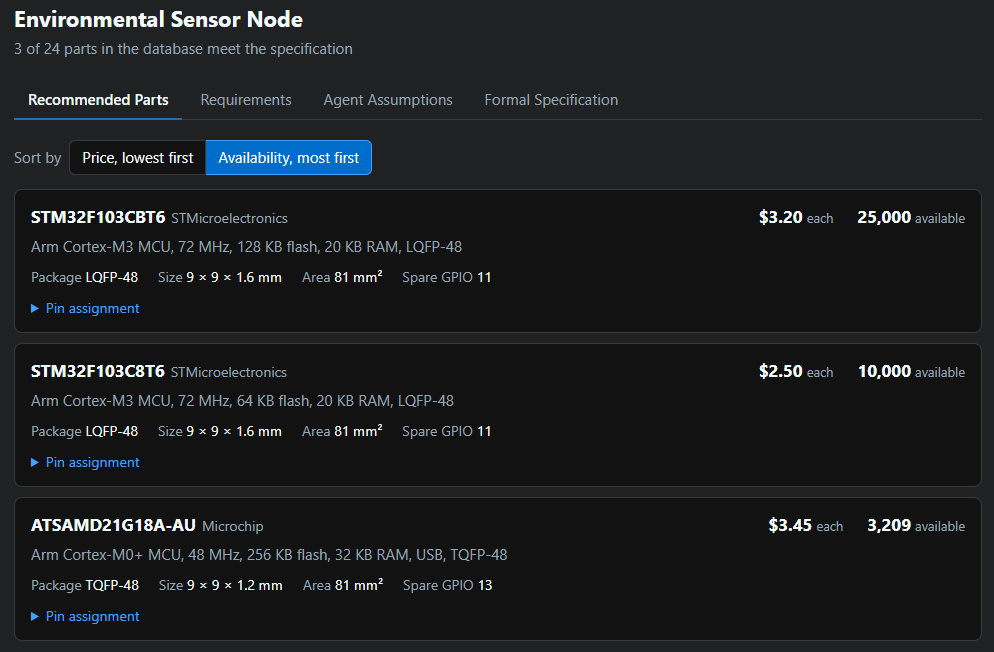
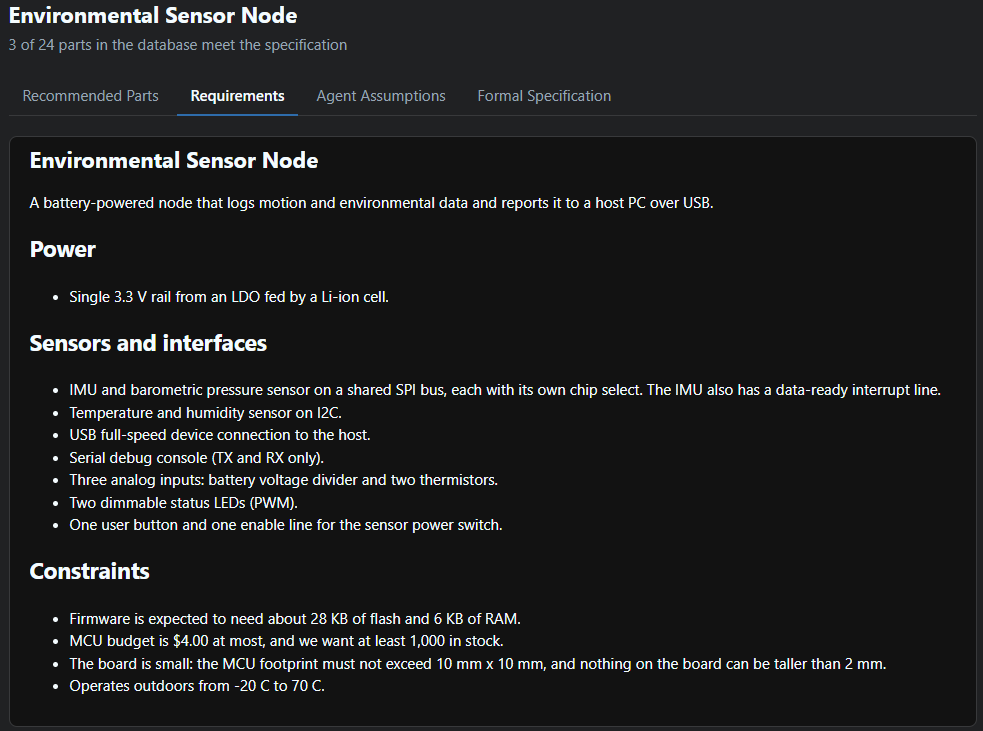
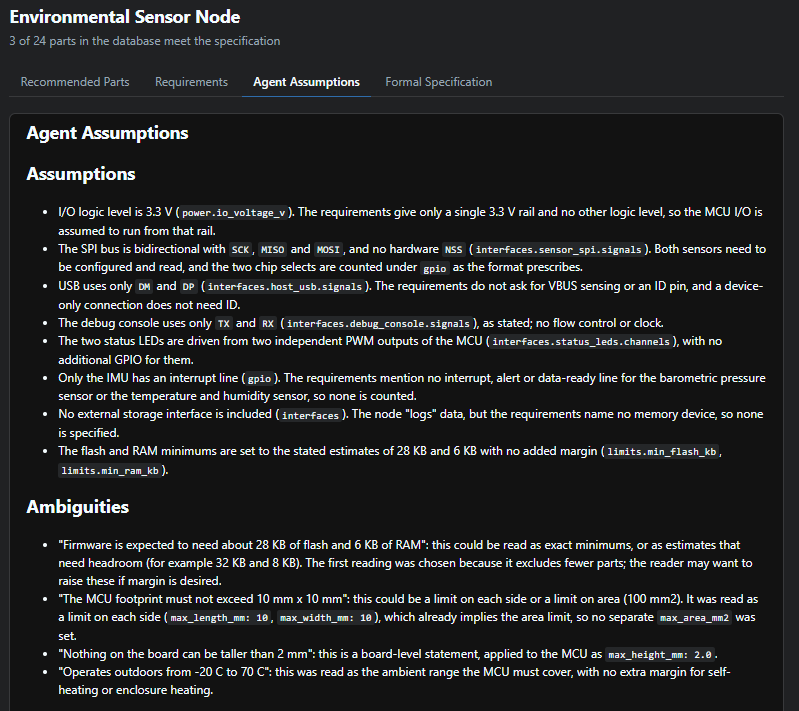
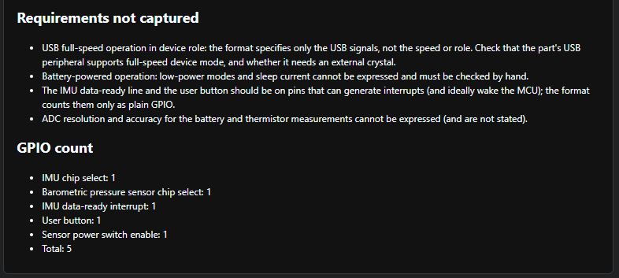
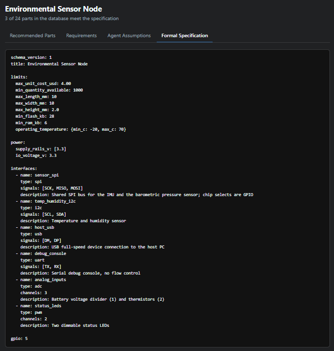

# ChipSelect

A recommendation engine for microcontroller selection in electronics.

You describe your circuit's requirements in plain English, and ChipSelect
lists the microcontrollers in its Parts Database that actually fit them.

## Motivation

Choosing a microcontroller is slow, mostly manual work. Distributor filters
narrow the field by headline numbers such as flash size or the count of SPI
buses, but they cannot say whether a part can provide everything a design
needs at the same time. Many microcontrollers offer far more peripherals than
they have pins, and most pins serve several purposes, so the real answer is
in the pin multiplexing tables of each candidate's datasheet, which commonly
runs to hundreds of pages. Working out a conflict-free pin assignment by hand
can take hours for a single part, and a careful comparison of a handful of
candidates typically takes an engineer anywhere from a few days to a couple
of weeks. Because of that cost, teams tend to evaluate only two or three
parts, often the ones they already know.

ChipSelect does the pin-level check for every part in its database in about a
second. A part is recommended only if every required signal and GPIO can be
placed on its own pin, and the assignment it found is included in the result.

The same check helps with supply risk. When a chosen part goes out of stock
or its lead time grows, as happened widely during the 2021-2022 chip
shortage, a design that was evaluated against only one or two parts has no
ready alternative, and finding one means repeating the evaluation under
schedule pressure. Because ChipSelect lists every part that fits, with price
and stock, the alternatives are known from the start, and the search can be
re-run in seconds whenever the requirements or the stock figures change.

## How it works

A single command runs three programs in order.

1. **Specification Agent.** An AI agent reads `Requirements.md`, guided by
   the instructions in `chipselect/agent_context.md`, and writes a Formal Specification.
   Requirements are often incomplete, so where it has to, the agent makes
   minimal assumptions and records every one of them in
   `agent_assumptions.md`. The agent is given no tools and cannot modify
   `Requirements.md`. Its output is validated against the specification
   schema and it is asked to correct any errors.
2. **Part Evaluator.** A deterministic program (no agent) checks every part
   in the Parts Database against the Formal Specification and writes
   `recommended_parts.yaml`: the parts that meet every criterion, each with
   its price, availability and a pin assignment that works.
3. **Summary Viewer.** Produces `summary.html`, a single self-contained page
   with four tabs: the recommended parts (sortable by price or by
   availability), the requirements, the agent's assumptions, and the Formal
   Specification.

## Example output

These screenshots show `summary.html` for the sensor node example in
`examples/sensor_node/`.

**Recommended Parts**, sorted by price (the default) and by availability.
Each part expands to show its pin assignment.

**Requirements**, as written by the user.

**Agent Assumptions**: what the agent assumed, the ambiguities it resolved,
the requirements it could not capture, and how it counted GPIO.

**Formal Specification**, as passed to the Part Evaluator.

## Usage

Requirements: Python 3.10 or later, and [Claude Code](https://claude.com/claude-code)
installed and logged in (the Specification Agent runs through `claude -p`).

    pip install -r requirements.txt
    python -m chipselect examples/sensor_node/Requirements.md

Each run calls a Claude model through your Claude Code login and counts
against that account's usage, with up to three calls if the agent's output
has to be corrected. Runs with `--skip-agent` make no model calls.

The outputs are written to an `output/` directory next to the requirements
file:

| File | Contents |
|------|----------|
| `formal_specification.yaml` | The Formal Specification written by the agent |
| `agent_assumptions.md` | Assumptions, ambiguities and requirements the specification could not capture |
| `recommended_parts.yaml` | Parts that meet the specification, with price, availability and pin assignment |
| `summary.html` | The summary page; open it in a browser |

Options:

| Option | Effect |
|--------|--------|
| `--out DIR` | Write the outputs to `DIR` |
| `--parts DIR` | Use a different Parts Database directory |
| `--model NAME` | Claude model for the Specification Agent |
| `--skip-agent` | Reuse the Formal Specification and assumptions already in the output directory, and re-run only the Part Evaluator and Summary Viewer |

Each stage can also be run on its own:

    python -m chipselect.spec_agent Requirements.md --out DIR
    python -m chipselect.evaluator formal_specification.yaml --parts parts/
    python -m chipselect.viewer --recommended recommended_parts.yaml --requirements Requirements.md \
        --assumptions agent_assumptions.md --spec formal_specification.yaml

## Writing requirements

`Requirements.md` is free-form English. Describe what the microcontroller has
to connect to and any constraints on it, for example supply voltage, sensors
and buses, analog inputs, PWM outputs, memory, cost, stock, size and
operating temperature. See `examples/` for three samples of varying
completeness.

Anything the Formal Specification cannot express (wireless connectivity,
low-power modes, a preferred vendor) is listed in `agent_assumptions.md`
under "Requirements not captured" for you to check by hand.

## Formal Specification

A YAML file of hard requirements, defined by `schemas/spec.schema.yaml` and
described for the agent in `chipselect/agent_context.md`. It contains:

- **Limits** (all optional): maximum unit cost, minimum stock, maximum area,
  length, width and height, minimum flash, RAM and clock speed, acceptable
  CPU cores, and operating temperature range.
- **Power**: the supply rails available on the board and the I/O voltage.
- **Interfaces**: buses (SPI, I2C, UART, CAN, USB, Ethernet, external flash)
  with the signals each needs, and channel counts for ADC, DAC and PWM.
- **GPIO**: the number of plain GPIO pins needed beyond the interfaces.

A part that fails any one requirement is excluded. Check a specification
with `python -m chipselect.spec <file>`.

## Parts Database

The database is the `parts/` directory, with one YAML file per
microcontroller in the format defined by `schemas/part.schema.yaml`. Each
part records:

- unit cost and quantity available
- package, with length, width and height (area is derived)
- CPU core, maximum clock, flash, RAM and operating temperature range
- required power supplies and possible I/O voltages
- headline counts: analog inputs and outputs, GPIO, SPI, I2C, UART and CAN
  buses, PWM-capable pins, USB, Ethernet and external flash controllers
- the connectivity between internal peripherals and device pins: for every
  peripheral signal, the pins it can be multiplexed onto

The pin connectivity also captures peripherals whose pins can only be
remapped as a group, serial units that can act as one of several bus types
but not two at once, and pins normally kept for debug, boot or a crystal,
which the evaluator uses only as a last resort.

Check the database with `python -m chipselect.parts_db parts/`.

### Adding a part

1. Copy an existing file in `parts/` that resembles the new part and name it
   after the full orderable part number (write any "/" as "_" in the file
   name).
2. Fill it in from the manufacturer's datasheet. The descriptions in
   `schemas/part.schema.yaml` explain each field.
3. Run `python -m chipselect.parts_db parts/`. It checks the file against the
   schema and reports any headline count that disagrees with the pin map.
4. Record your sources, and anything you assumed, in `parts/README.md`.

### Data accuracy

**The part data is not authoritative.** It was compiled by an AI model from
datasheets and pin databases found online and, in places, from recall;
prices and stock are not live. See [`parts/README.md`](parts/README.md) for
the disclaimer and the sources and assumptions behind each part.

## Limitations

- **Microcontrollers only.** Other kinds of parts cannot be described or
  selected.
- **Small database.** There are 24 parts, so "no part fits" often means only
  that a suitable part has not been added.
- **Unverified part data.** Nobody has reviewed the entries against the
  datasheets, and prices and stock are not live; see
  [`parts/README.md`](parts/README.md).
- **One pin assignment, not the best one.** The evaluator reports the first
  assignment that works. It does not optimise for layout, and it ignores
  electrical details such as drive strength, 5 V tolerance, clocking and
  which pins can wake the part or raise interrupts.
- **Hard requirements only.** Preferences and "nice to have" items cannot be
  expressed, so they are either left out or noted in `agent_assumptions.md`.
- **The agent can misread requirements.** The Formal Specification is checked
  for format, not for whether it reflects what you meant. Read it and
  `agent_assumptions.md` before trusting a result.

## Project layout

| Path | Contents |
|------|----------|
| `chipselect/` | The three programs, the command-line entry point, and `agent_context.md`, the instructions given to the Specification Agent |
| `schemas/` | Schemas for the Parts Database and the Formal Specification |
| `parts/` | The Parts Database |
| `examples/` | Example requirements files |
| `tests/` | Tests for the Part Evaluator |
| `screenshots/` | The architecture diagram and summary page screenshots used in this README |

Run the tests with:

    python -m unittest discover -s tests -t .

## License

Released under the MIT License; see [`LICENSE`](LICENSE).
